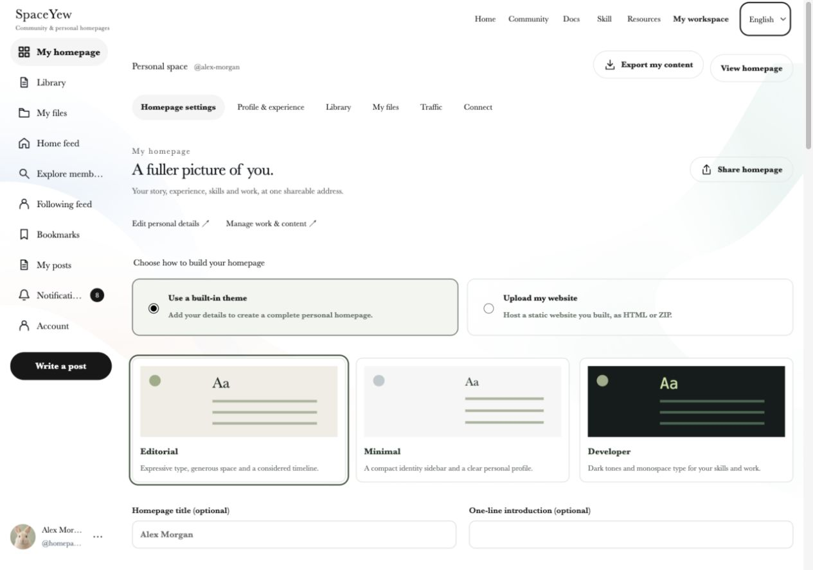

# SpaceYew

**English** | [简体中文](README.zh-CN.md)

**Let your work tell your story.**

SpaceYew brings personal homepages and a knowledge-sharing community together. Introduce yourself in depth through your story, experience, skills, work and contact links. Choose a built-in theme, or upload a static website you designed yourself; share it through a branded link and QR code.

This repository contains the website's frontend, backend, tests and deployment examples, making its interface, content model and permission system available to study. It is built with Next.js, React, TypeScript and Node.js's built-in SQLite.

> **Source available for reading and study only.** Direct use, modification, deployment (including personal or non-commercial deployment), commercial use and redistribution require prior written permission from IntMainJhy. See [LICENSE](LICENSE) for the full terms and English summary. This project is not offered under an open-source license such as MIT, Apache or GPL.

**This repository publishes only the website. macOS and Windows client source code, installers and proprietary assets remain private. This repository's license grants no rights to use or distribute those clients.** Viewing and forking on GitHub remain subject to GitHub's applicable terms.

## Preview

Screenshots of the English interface with English sample posts and fictional member profiles, captured in a local demo environment. The website also supports Simplified Chinese and Japanese.

### Homepage

An introduction to SpaceYew, the Skill installation entry and site navigation.


### Community

A feed of shared work, member recommendations and category navigation.


### Personal homepage settings

Choose an Editorial, Minimal or Developer theme, preview your personal profile, or upload an HTML/ZIP website.



### Personal homepage

A profile-first page for your introduction, skills, experience and work.


## Features

| Area | Capabilities |
| --- | --- |
| Personal homepages | Present your introduction, experience, skills, work and contact details using three responsive themes, with optional notes and resources |
| Static website hosting | Upload HTML or a ZIP with relative CSS/JS/assets, inspect an isolated preview, then submit a fixed version for review; public pages retain SpaceYew branding |
| Content and files | Edit projects, articles and resources in account-isolated workspaces; manage drafts, versions, images, attachments and file references |
| Sharing & community profiles | Copy a public link, share with the system sheet or download a QR code; community profiles show a short introduction and link to the full personal homepage |
| Developer community | Browse posts, discover members, follow, like, bookmark, repost and comment; submissions are reviewed before publication |
| Skill directory | Discover 16 GitHub Agent Skills across engineering, design, testing, documents, knowledge management and agent extensions; search by task, filter by type, open detailed features, use cases and supported AI tools, and copy tool-specific installation commands and ready-to-use prompts, with practical input-to-output examples |
| Administration | Role-based content review, reports, notifications, traffic statistics and audit logs for owners, reviewers and members |
| Tool integration | Connect to the website workspace through a submission Skill and local MCP integration, with scoped access to content and drafts |

The download page can link to externally hosted client installers. Client binaries and source code are not stored in this repository.

## Interface and interaction

A white-and-ink palette, flowing pastel backgrounds and editorial serif typography give the website a consistent visual language. The community uses an X-style social layout, while the workspace provides a wider editing area. GSAP connects page and navigation transitions, and the promotional strip keeps scrolling continuously during in-site navigation.

The interface supports English, Simplified Chinese and Japanese across desktop, tablet and mobile, with keyboard interaction and reduced-motion behavior. Themes chosen by homepage authors are independent of the shared website interface.

Static hosting accepts UTF-8 HTML (5 MB) or ZIP files (25 MB compressed, 50 MB extracted, up to 1,000 entries). Packages need `index.html` or `index.htm` and relative asset paths. Browser-side interactions work in an opaque-origin sandbox; external scripts, API requests, forms and server-side execution are blocked. Sources and extracted files count toward storage, with up to 20 immutable packages per account. Publishing remains limited to the existing local qualification and review workflow; this change does not enable public uploads on a production service. Backups retain source packages and restore their verified static assets.

Legacy `/u/...` and `/workspace/studio` website URLs redirect to personal homepages and their settings. Existing content and backend data contracts remain intact.

## Technology

| Layer | Implementation |
| --- | --- |
| Pages and API | Next.js 15 App Router, server-rendered pages and same-site APIs |
| Interface | React 19, TypeScript 5, CSS and GSAP |
| Rich text | Tiptap |
| Runtime and storage | Node.js 24.15+, built-in SQLite and a private file directory |
| Email and media | Nodemailer, Sharp and QRCode |
| Validation and deployment | Node.js test runner, isolated HTTP tests, Nginx and systemd examples |

## Project status

SpaceYew is under active development. Publishing its source demonstrates the implementation; it does not certify production deployment, email delivery or readiness to open the community to the public.

This repository covers website development only. macOS and Windows clients remain private. Client source, installers and real site data are not included.

## Repository layout

| Directory | Contents |
| --- | --- |
| `src/app/` | Pages, APIs, media/download routes and styles |
| `src/components/` | Website components and shared interactions |
| `src/lib/` | Authentication, content, community, workspaces, files, email, database and permissions |
| `test/` | Unit tests, isolated HTTP tests and explicitly run demo scripts |
| `scripts/` | Initialization, backup, restore, cleanup and Skill packaging |
| `integrations/` | Website submission Skill, MCP integration and request scripts |
| `deploy/` | Nginx, systemd and separate platform/admin deployment examples |
| `public/` | Static website assets and the generated submission Skill package |
| `docs/` | Website administration guides, screenshots and third-party licenses |

Local databases, user uploads, captured email, real environment variables, credentials, backups, local design-review artifacts, temporary previews, dependencies and build output are excluded. Passwords in demo scripts are synthetic test values, not live site credentials.

## Local development for authorized maintainers

These instructions are for the copyright holder, maintainers and people with separate written authorization. They do not expand the permissions in LICENSE.

Use Node.js **24.15 or a newer compatible version**, npm and the committed lockfile. Database access uses a single Node process; multiple instances must not write concurrently to the same upload directory.

```sh
git clone https://github.com/IntMainJhy/SpaceYew.git
cd SpaceYew
npm ci
cp .env.local.example .env.local
npm run setup
npm run dev
```

The default local URL is `http://127.0.0.1:3008/`. The repository is already the website root; there is no additional `site-v1` directory to enter. Preserve any existing environment file.

`APP_DATA_DIR` defaults to `../.site-v1-data`, outside the application directory, and can be set to another private absolute path. On first initialization, randomly generated administrator credentials are saved to `initial-admin.txt` in the actual data directory. Re-running setup does not reset existing data. Never upload that file, the database or real configuration.

The local environment template contains only loopback URLs and cookie settings. For email, configure SMTP using [.env.example](.env.example); local capture mode is for integration testing. Real SMTP delivery, backup restoration and production deployment require separate validation in the target environment.

```sh
npm test
npm run typecheck
npm run build
npm run test:homepage:http
npm start
```

HTTP integration scripts in `test/` use temporary data directories. Check that their test ports are free before running them. Demo seeding and data-refresh scripts do not run as part of regular tests and should target only explicitly designated test data.

## Deployment and administration

- [Separate platform and admin deployment](deploy/README-split.en.md)
- [Administration guide](docs/administration.en.md)
- Configuration examples: [platform](deploy/platform.env.example), [admin](deploy/admin.env.example) and [Nginx](deploy/nginx-split.conf.example).

Production requires a separate private data directory, correct HTTPS URLs, Secure cookies and a trusted proxy configuration. Client links, ICP registration details, account settings and email settings must match the actual site. Default content and registration identifiers in the code do not authorize their use on another site.

## License and permission

Original material is provided under the [SpaceYew Website Source Reading and Study License 1.0](LICENSE), for reading and study only. Other uses require prior written permission. Contact [IntMainJhy](https://github.com/IntMainJhy) through the author's public contact channels, describing your purpose, intended modifications, deployment scope and any commercial use.

LICENSE includes an English summary; its Chinese text controls if there is a discrepancy. Third-party materials retain their own licenses; see [THIRD_PARTY_NOTICES.md](THIRD_PARTY_NOTICES.md).
