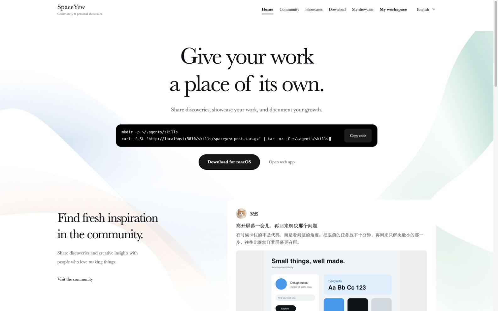
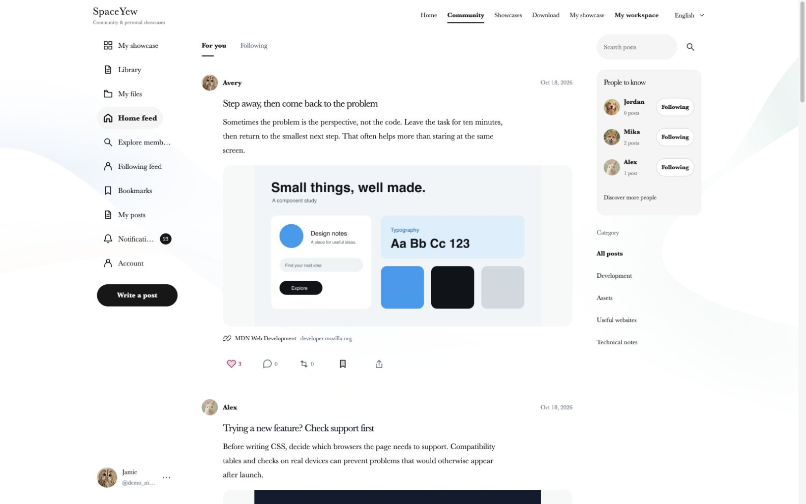
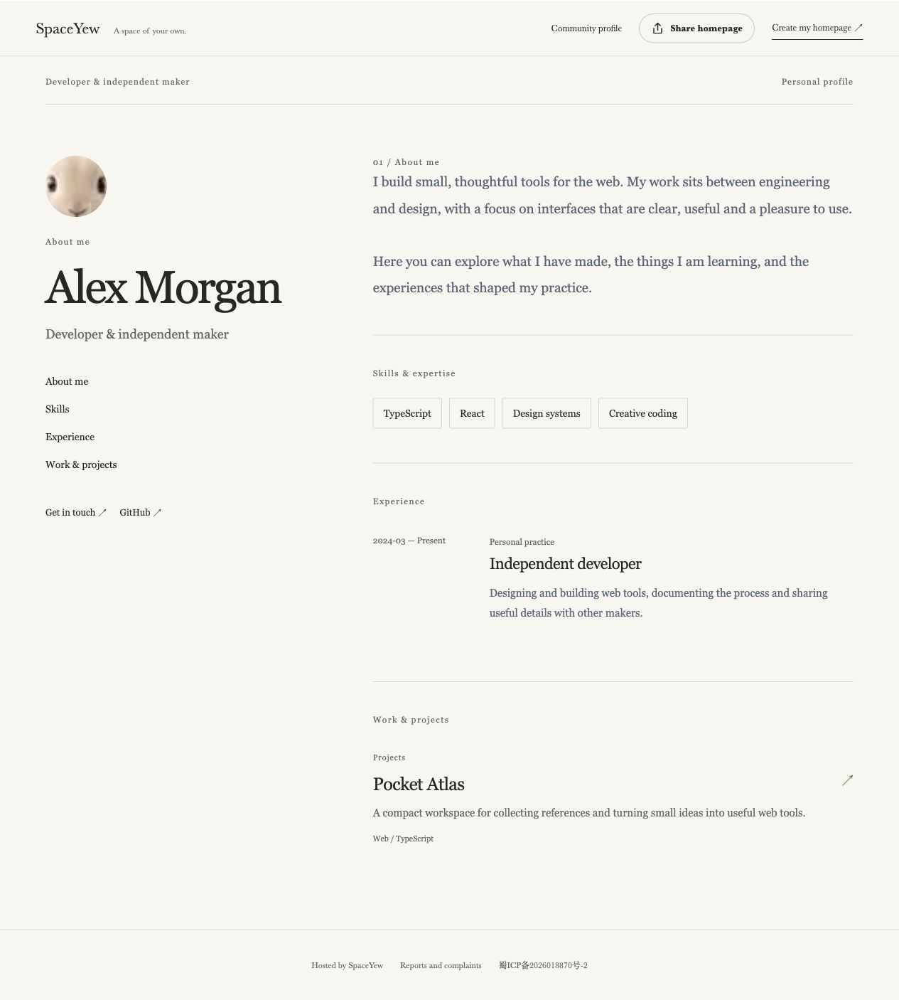

# SpaceYew

**English** | [简体中文](README.zh-CN.md)

**Let your work tell your story.**

SpaceYew is a developer portfolio and knowledge-sharing platform. Turn a résumé into an editable blog homepage, present your work and certificates, and share tutorials, independent AI Skills and useful tools through a connected community. Each member owns their profile, drafts and uploaded files.

The current blog editor uses an Anx Portfolio-inspired layout. Existing HTML/ZIP hosting remains available through the backend APIs; a static-site upload interface and theme selector are not part of the current editor.

[GitHub repository](https://github.com/IntMainJhy/SpaceYew) · [AtomGit mirror](https://atomgit.com/InMainJhy/SpaceYew) · [Documentation](docs/README.md)

This repository contains the website's frontend, backend, tests and deployment examples, making its interface, content model and permission system available to study. It is built with Next.js, React, TypeScript and Node.js's built-in SQLite.

> **Source available for reading and study only.** Direct use, modification, deployment (including personal or non-commercial deployment), commercial use and redistribution require prior written permission from IntMainJhy. See [LICENSE](LICENSE) for the full terms and English summary. This project is not offered under an open-source license such as MIT, Apache or GPL.

**This repository publishes only the website. macOS and Windows client source code, installers and proprietary assets remain private. This repository's license grants no rights to use or distribute those clients.** Viewing and forking on GitHub remain subject to GitHub's applicable terms.

## What SpaceYew is for

- **Developers:** build a shareable résumé homepage with projects, experience, skills and compact certificate galleries.
- **Authors and curators:** publish categorized tutorials, third-party Skills and useful resources, with source and license information.
- **AI-assisted workflows:** let an authorized agent prepare private drafts and submit them through scoped REST credentials or a local stdio MCP bridge.
- **Site operators:** review flagged submissions, handle reports and takedowns, manage accounts and preserve an audit trail.

SpaceYew is being developed as a shared service with account-isolated data. The repository currently supports qualified local test accounts; it is not a live public SaaS offering.

## Preview

Local previews of the English interface with English sample posts and fictional member profiles. These screenshots show the earlier homepage and community design; the current editor and catalog capabilities are described below. The website also supports Simplified Chinese and Japanese.

### Homepage

An introduction to SpaceYew, the Skill installation entry and site navigation.



### Community

A feed of shared work, member recommendations and category navigation.



### Blog homepage

The main Blog homes entry opens the site owner’s public Anx Portfolio homepage directly, with their introduction, skills, experience and work. Editing stays on a separate page: **Create / edit my blog** opens the signed-in member’s own content. The owner can use **Administration → Blog homes** at `/admin/blog`. See the [blog editing guide](docs/blog-editor.md).



## Features

| Area | Capabilities |
| --- | --- |
| Accounts | Invitation-free email registration with a six-digit, expiring code; real email/password sign-in, private blog drafts and separate publication qualification; currently local only |
| Blog homepages | The site owner’s public Anx Portfolio profile opens directly, without a template picker or workspace panels; each signed-in member can edit their own profile, résumé sections, metrics, certificates, images and public PDF at `/workspace/blog`, then preview and submit a fixed version for review |
| Existing static website hosting | Backend APIs accept HTML or ZIP packages with relative CSS/JS/assets, isolate previews and submit fixed versions for review; existing hosted sites and stable sharing URLs remain supported |
| Shared documentation | Categorized image-and-description boards, article details with section navigation, and member-authored tutorials; import text, Markdown or HTML into the editor |
| Skill directory | 17 independently maintained GitHub Skills: Vercel React/composition, Impeccable, UI UX Pro Max, Superpowers debugging/TDD, Obsidian Markdown/JSON Canvas, eight GSAP Skills and VibeHub; cover cards, category/search/tool filters, detailed scenarios, installation commands and localized copyable prompts |
| Other resources | Member-shared websites, tools and references; documentation and Skills have their own sections |
| Publishing & community | Write an original text post directly in the community, or publish from the Docs, Skills or Other resources editor; an approved catalog entry creates one linked community post, later revisions reuse it, and taking the entry offline removes its share from public view |
| Sharing & community profiles | Direct public blog navigation, public links, system sharing and QR codes; community profiles retain a short introduction with a link to the full blog |
| Résumé import | Local PDF, DOCX, TXT and Markdown text extraction into a reviewable profile draft; original uploads stay private, and a separate redacted PDF can be selected for public download |
| Content and files | Private account-isolated drafts, versions, blog content, uploaded images, attachments and file references |
| Moderation & administration | Local risk screening can approve low-risk text; flagged text, images, external sources and installation commands wait for a reviewer; manual mode, reports, takedowns, notifications and audit logs remain available |
| AI integration | The SpaceYew Skill and local stdio MCP bridge can read, save and submit documents, Skills and resources through scoped credentials; publication uses the same moderation and community-sharing pipeline as the editor |

The download page can link to externally hosted client installers. Client binaries and source code are not stored in this repository.

## Interface and interaction

A white-and-ink palette, flowing pastel backgrounds and editorial serif typography give the website a consistent visual language. The community uses an X-style social layout, while blog management and publishing have independent editing areas. GSAP connects page and navigation transitions, and the promotional strip keeps scrolling continuously during in-site navigation.

The interface supports English, Simplified Chinese and Japanese across desktop, tablet and mobile, with keyboard interaction and reduced-motion behavior. The current member editor uses the Anx résumé layout; previously stored theme settings remain compatible with existing content.

Static hosting accepts UTF-8 HTML (5 MB) or ZIP files (25 MB compressed, 50 MB extracted, up to 1,000 entries). Packages need `index.html` or `index.htm` and relative asset paths. Browser-side interactions work in an opaque-origin sandbox; external scripts, API requests, forms and server-side execution are blocked. Sources and extracted files count toward storage, with up to 20 immutable packages per account. Publishing remains limited to the existing local qualification and review workflow; this change does not enable public uploads on a production service. Backups retain source packages and restore their verified static assets.

Legacy `/u/...` URLs redirect to public blogs; former workspace pages redirect to the independent blog editor. Existing content and backend data contracts remain intact. See the [static hosting guide](docs/blog-hosting.md) for packaging, previews and supported interactions.

## Publishing and AI workflows

The top-level sections are Home, Community, Blogs, Docs, Skills and Other resources. For an original community post, write a title and text directly; external links and a separate summary are optional. Normal original text can publish after automatic checks, while images, external sources, flagged content or manual mode require review. Use the publish action on each catalog page to create a document, Skill or resource, then save a private draft or submit it. Every published entry keeps its author, source and usage terms. If no image is supplied, SpaceYew generates a typographic cover. Documents and Skills appear in their own catalogs; an approved submission also creates a linked community share automatically. There is no need to submit the same content again in the community.

Each member owns their drafts and credentials. Existing public content stays visible while a revision awaits review. Suspicious content remains private to the author and reviewers, and linked reports or takedowns affect public visibility. The current rules engine is local triage, not semantic AI moderation or a guarantee of legal compliance. Public production publishing remains gated; see [moderation and launch requirements](docs/moderation-and-launch.md).

For AI publishing, a qualified local account can create a credential through the authenticated `/api/spaces/keys` API with **catalog** scope, adding **submit** only if the agent may submit content for publication. The former `/workspace/connect` page currently redirects to the blog editor; it is not a working credential-management screen. See [credential setup](integrations/spaceyew-post/references/api.md#credential-setup-local-accounts). Existing library/community credentials are not silently expanded. Configure the [stdio MCP bridge](integrations/spaceyew-mcp.mjs) or [SpaceYew Skill](integrations/spaceyew-post/SKILL.md) with a private site URL and token. The workflow is `catalog.save`, then `catalog.submit` after authorization and reading the current policy. A submission returns its actual published or pending status; it cannot approve its own review. Writes use stable request IDs to prevent duplicate retries. See the [API reference](integrations/spaceyew-post/references/api.md) for fields and MCP setup.

The curated Skill directory links to upstream repositories rather than bundling third-party code. It focuses on independent projects rather than duplicating skills bundled with AI tools; the previously listed Anthropic examples and document Skills have been removed. Tool badges describe the installation paths documented by this directory, not universal compatibility. GSAP Skills use MIT; the GSAP runtime has separate license terms.

### A typical publishing flow

1. Sign in with a real website account and open the editor from the relevant catalog or **Create / edit my blog**.
2. Add your content, check extracted résumé facts, remove private details and preview your draft.
3. Save privately, then submit a fixed version for review. Saving alone does not publish. The owner’s separately labeled admin publication action is an exception.
4. Share the approved public link. Approved catalog entries also appear in the community automatically.
5. Revise the draft without replacing the public version until approval; take content offline when needed.

## Technology

| Layer | Implementation |
| --- | --- |
| Pages and API | Next.js 15 App Router, server-rendered pages and same-site APIs |
| Interface | React 19, TypeScript 5, CSS and GSAP |
| Rich text | Tiptap |
| Runtime and storage | Node.js 24.15+, built-in SQLite and a private file directory |
| Email and media | Nodemailer, Sharp and QRCode |
| Validation and deployment | Node.js test runner, isolated HTTP tests, Nginx and systemd examples |

## Project status

SpaceYew is under active development. Publishing its source demonstrates the implementation; it does not certify production deployment, email delivery or readiness to open the community to the public.

This repository covers website development only. macOS and Windows clients remain private. Client source, installers and real site data are not included.

The [2026-10-22 audit report](docs/audit-2026-10-22.md) records an earlier scoped review and its checks, including 162 unit tests, type checking, a production build and three HTTP suites. That result applies to the reviewed version and environment, not a guarantee of production readiness.

## Documentation

| Task | Guide |
| --- | --- |
| Register and configure email | [Email registration and SMTP](docs/email-registration.md) |
| Edit and publish a blog | [Blog editor](docs/blog-editor.md) |
| Import a résumé safely | [Résumé import](docs/resume-import.md) |
| Understand static hosting | [Hosting and sandbox limits](docs/blog-hosting.md) |
| Connect an AI tool | [API and stdio MCP reference](integrations/spaceyew-post/references/api.md) |
| Operate the platform | [Administration](docs/administration.en.md) · [Deployment](deploy/README-split.en.md) |
| Review launch boundaries | [Moderation and launch](docs/moderation-and-launch.md) · [Audit](docs/audit-2026-10-22.md) |
| Understand assets and permissions | [Brand assets](docs/brand.md) · [Third-party notices](THIRD_PARTY_NOTICES.md) |

## Repository layout

| Directory | Contents |
| --- | --- |
| `src/app/` | Pages, APIs, media/download routes and styles |
| `src/components/` | Website components and shared interactions |
| `src/lib/` | Authentication, content, community, workspaces, files, email, database and permissions |
| `test/` | Unit tests and isolated HTTP tests with disposable fixtures |
| `scripts/` | Initialization, backup, restore, cleanup and Skill packaging |
| `integrations/` | Website submission Skill, MCP integration and request scripts |
| `deploy/` | Nginx, systemd and separate platform/admin deployment examples |
| `public/` | Static website assets and the generated submission Skill package |
| `docs/` | Website administration guides, screenshots and third-party licenses |

Local databases, user uploads, captured email, real environment variables, credentials, backups, local design-review artifacts, temporary previews, dependencies and build output are excluded. Runtime demo accounts, automatic sign-in and data-seeding scripts have been removed. Automated regression tests use disposable fixtures, never live credentials.

## Local development for authorized maintainers

These instructions are for the copyright holder, maintainers and people with separate written authorization. They do not expand the permissions in LICENSE.

Use Node.js **24.15 or a newer compatible version**, npm and the committed lockfile. Database access uses a single Node process; multiple instances must not write concurrently to the same upload directory.

```sh
git clone https://github.com/IntMainJhy/SpaceYew.git
cd SpaceYew
npm ci
cp .env.local.example .env.local
npm run setup
npm run dev
```

The default local URL is `http://127.0.0.1:3008/`. The repository is already the website root; there is no additional `site-v1` directory to enter. Preserve any existing environment file.

`APP_DATA_DIR` defaults to `../.site-v1-data`, outside the application directory, and can be set to another private absolute path. On first initialization, randomly generated administrator credentials are saved to `initial-admin.txt` in the actual data directory. Re-running setup does not reset existing data. Never upload that file, the database or real configuration.

The local environment template contains only loopback URLs and cookie settings. For email, configure SMTP using [.env.example](.env.example); local capture mode is for integration testing. Real SMTP delivery, backup restoration and production deployment require separate validation in the target environment.

```sh
npm test
npm run typecheck
npm run build
npm run test:homepage:http
npm run test:resume:http
npm run test:blog-editor:http
npm start
```

HTTP integration scripts in `test/` use temporary data directories. Check that their test ports are free before running them. Tests create and remove their own accounts and content; they must not target an existing site data directory.

## Deployment and administration

The recommended deployment uses one codebase and database with separate platform and administration subdomains. `APP_SURFACE` and server-side permissions isolate the two services and their sessions. Administrators sign in only on the admin surface, members on the platform; neither arbitrary-account experience login nor automatic demo access is available.

- [Separate platform and admin deployment](deploy/README-split.en.md)
- [Administration guide](docs/administration.en.md)
- Configuration examples: [platform](deploy/platform.env.example), [admin](deploy/admin.env.example) and [Nginx](deploy/nginx-split.conf.example).

Production requires a separate private data directory, correct HTTPS URLs, Secure cookies and a trusted proxy configuration. Client links, ICP registration details, account settings and email settings must match the actual site. Default content and registration identifiers in the code do not authorize their use on another site.

## License and permission

Original material is provided under the [SpaceYew Website Source Reading and Study License 1.0](LICENSE), for reading and study only. Other uses require prior written permission. Contact [IntMainJhy](https://github.com/IntMainJhy) through the author's public contact channels, describing your purpose, intended modifications, deployment scope and any commercial use.

LICENSE includes an English summary; its Chinese text controls if there is a discrepancy. Third-party materials retain their own licenses; see [THIRD_PARTY_NOTICES.md](THIRD_PARTY_NOTICES.md).

- [Community completion review](docs/community-finish-2026-10-22.md)
