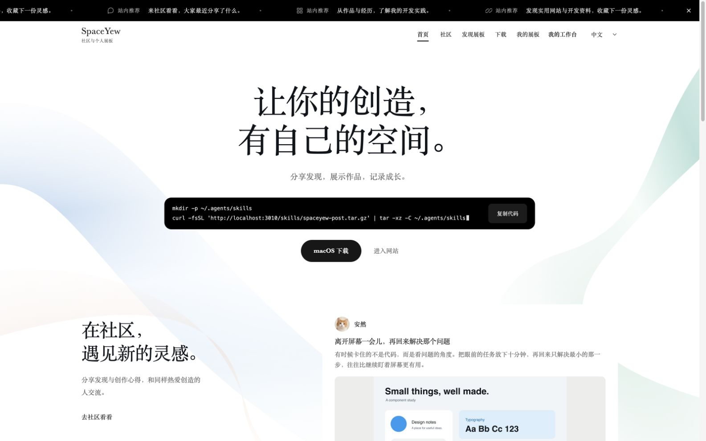
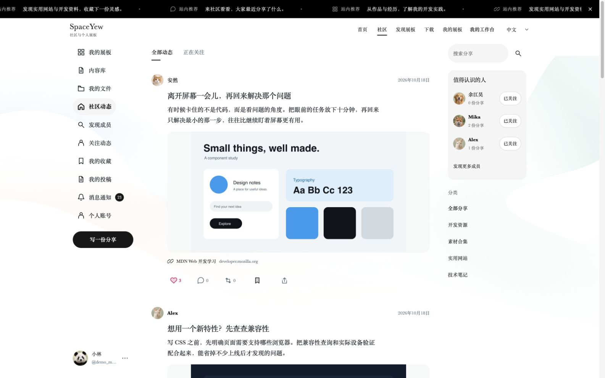
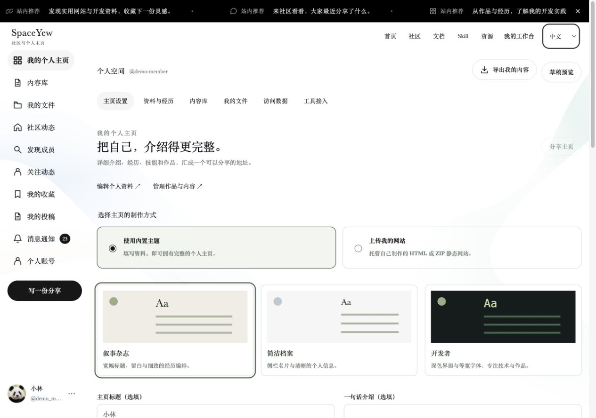
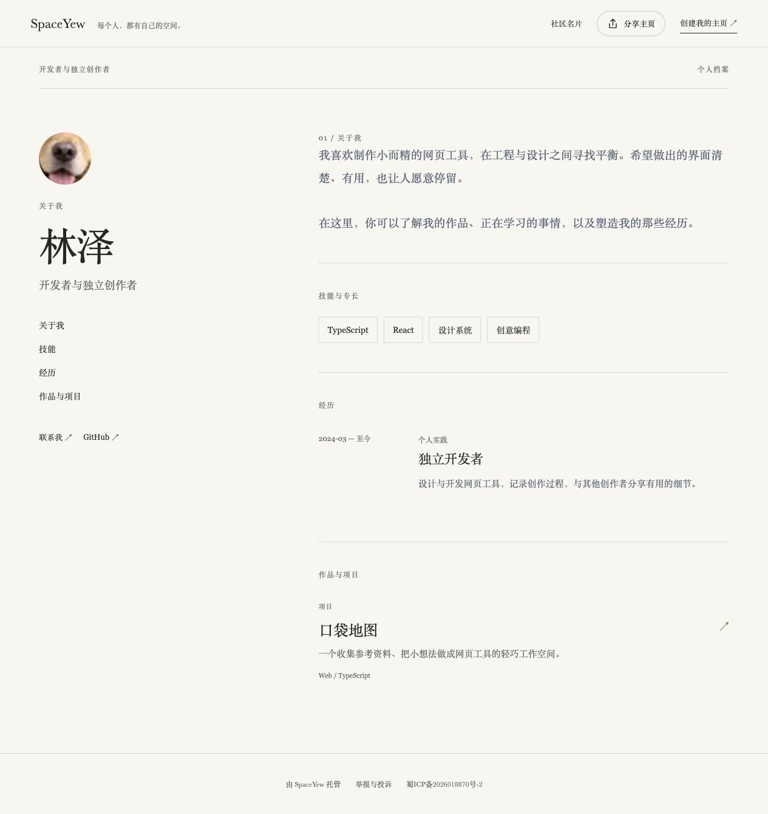

# SpaceYew

[English](README.md) | **简体中文**

**让做过的事，成为被看见的你。**

SpaceYew 将博客主页、共享文档、独立 AI Skill 和实用资源汇聚到同一个社区。成员可以用自己的账号介绍经历、发布教程和分享工具；选择内置博客主题，或上传自己制作的静态网站，通过专属链接和二维码分享。

本仓库提供网站的完整前端、后端、测试及部署示例，方便阅读其界面、内容组织和权限治理的实现。网站基于 Next.js、React、TypeScript 和 Node.js 内置 SQLite 构建。

> **源码可见，仅供阅读学习。** 修改使用、直接使用、部署（包括个人或非商业部署）、商用和再分发，均须取得 IntMainJhy 的事先书面许可。完整条款见 [LICENSE](LICENSE)。本项目不采用 MIT、Apache 或 GPL 等开放许可。

**本仓库只发布网站。macOS、Windows 客户端的源码、安装包和专有资源不在本仓库发布，本仓库的许可不授予客户端使用或分发权利。** GitHub 平台内的查看与 Fork 按适用的平台条款处理。

## 界面预览

以下为本地演示环境的网页端截图，展示此前的首页与社区设计；当前栏目和主题能力见下方功能说明。

### 网站首页

欢迎介绍、Skill 安装入口与网站导航。



### 社区动态

分享信息流、成员推荐与分类导航。



### 博客主页设置

选择内置主题、预览个人资料，或上传 HTML / ZIP 静态网站。当前编辑器支持 Anx Portfolio 源码适配版、像素手记与远景日记等六套主题。



### 博客主页

以自我介绍为核心，清楚呈现技能、经历与作品。



## 网站功能

| 模块 | 可以做什么 |
| --- | --- |
| 博客主页 | 六套适配手机与桌面的主题，包括 Anx Portfolio 源码适配版、浅色格线 Folio 与深色大封面 Panorama；以介绍、经历、技能、作品和联系方式为主，文章与资源为可选栏目 |
| 静态网站托管 | 上传 HTML 或包含相对路径 CSS / JS / 素材的 ZIP；隔离预览、固定版本审核、稳定的分享地址，并提供中英文 HTML 入门模板 |
| 共享文档 | 分类封面看板、图片加简介、带左侧目录的详情阅读；成员可发布教程，将文本、Markdown 或 HTML 导入编辑器 |
| Skill 目录 | 17 项独立维护的 GitHub Skill：Vercel React/组件组合、Impeccable、UI UX Pro Max、Superpowers 排错/TDD、Obsidian Markdown/JSON Canvas、8 项 GSAP 与 VibeHub；支持封面卡片、分类/搜索/AI 工具筛选，以及场景、示例、安装命令和多语言提示词一键复制 |
| 其他资源 | 成员共同分享好用的网站、工具与参考资料；文档和 Skill 拥有独立栏目 |
| 发布与社区 | 文档、Skill、资源共用按账号隔离的发布入口；审核通过后自动生成一份关联社区分享，修订复用原动态，下架时联动停止公开 |
| 分享与社区名片 | 博客拥有独立导航和管理页，支持公开链接、系统分享和二维码；社区个人页保留简短介绍并连接完整博客 |
| 内容与文件 | 按账号隔离草稿、版本、博客内容、图片、附件和文件引用 |
| 审核与管理 | 本地规则可自动通过低风险文字；风险文字、图片、外部来源和安装命令等待复核；支持人工审核模式、举报、下架、通知和审计日志 |
| AI 工具接入 | SpaceYew Skill 与本地 stdio MCP 可通过独立凭据读取、保存和提交文档、Skill、资源，使用与网页相同的审核及社区同步流程 |

网站下载页可以配置外部客户端安装包链接，安装包及客户端源码均不存放在本仓库。

## 界面与交互

白底墨色、柔彩流动背景与杂志风格衬线字体构成网站的共同视觉语言。社区采用 X 社交式布局，博客管理和发布拥有独立编辑区域；页面切换与导航通过 GSAP 衔接，广告推荐条在站内切换时保持连续滚动。

界面提供中文、英文和日文，适配桌面、平板和手机，并为减少动态效果及键盘操作保留对应行为。博客作者的主题独立于网站共享界面。

静态托管支持 UTF-8 HTML（5MB）或 ZIP（压缩25MB、展开50MB、最多1000项），网站包需要 `index.html` 或 `index.htm`，素材使用相对路径。浏览器内交互在不透明来源的沙箱中运行；外部脚本、接口通信、表单提交和服务端执行均被阻止。源文件与解压文件均计入个人存储，每个账号最多保留20个不可变的网站包。公开仍遵循现有本地测试资格和审核流程，本次修改不会直接开放线上投稿。备份保留源包，恢复时重新校验并重建静态素材。

旧 `/u/...` 和 `/workspace/studio` 网页地址会跳转到博客及设置，原有内容与后端数据接口继续保留。打包方式、预览和交互范围见[静态托管指南](docs/blog-hosting.zh-CN.md)。

## 发布与 AI 工作流

顶部栏目为首页、社区、博客主页、文档、Skill、其他资源。通过「发布」创建内容，保存为私有草稿或提交发布；每份公开内容保留作者、来源与使用许可。没有上传图片时，平台自动生成文字封面。审核通过的内容进入相应栏目，同时自动生成关联社区动态，无需在社区重复投稿。

每个成员管理自己的草稿和工具凭据。新修订等待审核时，现有公开版本继续展示；风险内容仅作者及审核人员可见，关联举报和下架会影响公开状态。目前使用的是本地风险初筛规则，并非语义 AI 审核，也不代表合规认证。生产环境的公开投稿仍保留限制，具体见[审核与上线要求](docs/moderation-and-launch.md)。

需要 AI 发布时，在 `/workspace/connect` 创建具备 **catalog** 范围的凭据；只有允许 Agent 提交发布时才勾选 **submit**。已有内容库或社区凭据不会自动扩大权限。在私密配置中为 [stdio MCP](integrations/spaceyew-mcp.mjs) 或 [SpaceYew Skill](integrations/spaceyew-post/SKILL.md) 配置网站地址与令牌。流程为先 `catalog.save`，读取当前规则并获得发布授权后再 `catalog.submit`。接口返回真实的已发布或待复核状态，Agent 不能自行审批；写入请求的幂等标识避免重试产生重复内容。字段与 MCP 配置见 [API 参考](integrations/spaceyew-post/references/api.md)。

精选目录仅索引第三方原仓库，不打包第三方源码，避免重复收录 AI 工具自带的 Skill，并已移除此前的 Anthropic 示例及文档 Skill。工具标签表示本站整理的安装路径，不代表通用兼容性保证。GSAP Skills 采用 MIT，GSAP 运行库另有自身许可。

## 技术实现

| 层级 | 实现 |
| --- | --- |
| 页面与 API | Next.js 15 App Router，服务端页面与同站 API |
| 界面 | React 19、TypeScript 5、CSS、GSAP |
| 富文本编辑 | Tiptap |
| 运行与数据 | Node.js 24.15+、内置 SQLite、私有文件目录 |
| 邮件与媒体 | Nodemailer、Sharp、QRCode |
| 验证与部署 | Node.js 测试运行器、隔离 HTTP 测试、Nginx 与 systemd 示例 |

## 当前状态

项目仍处于开发阶段，持续完善网站功能、交互与维护流程。公开源码用于展示和阅读实现，不代表已完成生产部署、邮件投递或社区开放验收。

本仓库只承载网站开发；macOS 和 Windows 客户端继续保持私有。没有在仓库提供的客户端源码、安装包或真实站点数据，不属于本项目的交付内容。

## 目录

| 目录 | 内容 |
| --- | --- |
| `src/app/` | 页面、API、媒体/下载路由与样式 |
| `src/components/` | 网站界面及共享交互 |
| `src/lib/` | 认证、内容、社区、空间、文件、邮件、数据库与权限 |
| `test/` | 单元测试、隔离 HTTP 测试与显式执行的演示脚本 |
| `scripts/` | 初始化、备份、恢复、清理与 Skill 打包 |
| `integrations/` | 网站投稿 Skill、MCP 与请求脚本 |
| `deploy/` | Nginx、systemd 与平台/管理分入口部署示例 |
| `public/` | 网站静态资源与生成的投稿 Skill 包 |
| `docs/` | 网站管理说明、界面截图与第三方许可 |

本地数据库、用户上传、邮件记录、真实环境变量、凭据、备份、设计验收截图、临时预览、依赖和构建输出均不在仓库中。演示脚本中的测试密码仅用于隔离测试，不是现有站点凭据。

## 已授权维护者的本地开发

以下命令只面向著作权人、维护者及已取得书面授权的人；操作说明不扩大 LICENSE 中的权限。

要求 Node.js **24.15 或更新的兼容版本**，使用 npm 和随仓库提供的锁文件。数据库采用单 Node 进程访问，不应以多个实例共写同一上传目录。

```sh
git clone https://github.com/IntMainJhy/SpaceYew.git
cd SpaceYew
npm ci
cp .env.local.example .env.local
npm run setup
npm run dev
```

默认本地入口为 `http://127.0.0.1:3008/`。此仓库本身就是网站根目录，无需再进入 site-v1 子目录。如果已有环境文件，不要覆盖它。

`APP_DATA_DIR` 默认位于应用目录之外的 `../.site-v1-data`，可设置为其他私有绝对路径。首次初始化创建随机管理员凭据文件 `initial-admin.txt`，仅存放在实际数据目录；已有数据不会因重复 setup 自动重置。不要上传该文件、数据库或真实配置。

本地环境模板只包含 loopback URL 与 Cookie 配置。需要邮件功能时，参照 [.env.example](.env.example) 配置 SMTP；本机 capture 模式只用于联调。真实 SMTP 投递、备份恢复及正式部署需在目标环境单独验证。

```sh
npm test
npm run typecheck
npm run build
npm run test:homepage:http
npm start
```

HTTP 集成脚本位于 `test/`，使用临时数据目录执行；运行前确认测试端口未被开发服务占用。演示播种与数据刷新脚本不会由常规测试自动执行，应只对明确指定的测试数据运行。

## 部署与管理

- [平台/管理分入口部署](deploy/README-split.md)
- [管理中心说明](docs/管理中心说明.md)
- 配置示例：[平台](deploy/platform.env.example)、[管理](deploy/admin.env.example)、[Nginx](deploy/nginx-split.conf.example)。

正式环境须使用独立私有数据目录、正确的 HTTPS URL、Secure Cookie 及可信代理配置。客户端链接、备案展示、账号与邮件设置需与实际站点一致；代码中的默认资料与备案标识不可作为其他站点的授权证明。

## 许可与授权

原创部分按 [SpaceYew 网站源码阅读与学习许可 1.0](LICENSE) 提供，仅供阅读学习，其他使用需要事先书面授权。可通过 [IntMainJhy](https://github.com/IntMainJhy) 的公开联系渠道申请，说明用途、修改范围、部署范围及商业情况。许可文件附有英文摘要；如有差异，以中文条款为准。

第三方材料继续适用各自许可，参见 [THIRD_PARTY_NOTICES.md](THIRD_PARTY_NOTICES.md)。
